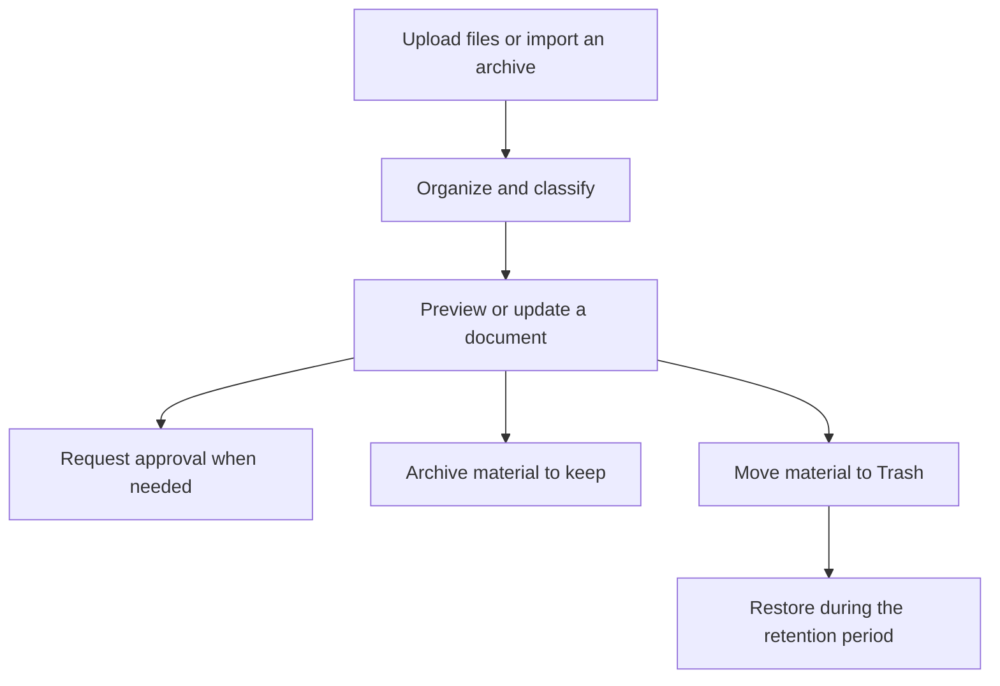
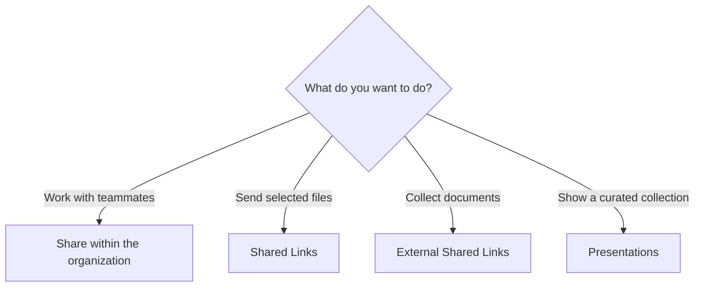

<h1 align="center">📁 SpectraVault</h1>

  <strong>Document management, approvals, and sharing for organizations</strong>

  <a href="https://vault.spectraeye.app/">Open SpectraVault</a> ·
  <a href="#-work-with-documents">Documents</a> ·
  <a href="#-share-and-collaborate">Collaboration</a> ·
  <a href="#-manage-your-organization">Organization</a> ·
  <a href="#-plans-and-renewals">Plans and renewals</a> ·
  <a href="#-get-started">Get started</a>

---

## 📘 Introduction

SpectraVault gives your team one workspace to organize documents, review work, and share the right materials with the right people. Use it to keep everyday files easy to find, route documents for approval, and manage access as your team grows.

## 📂 Work with documents

- **Organize and find files.** Browse folders in list or grid view, find files with search and filters, and add frequently used items to **Pinned**. Select several items to apply the same action to them.
- **Review versions.** Preview supported file types and use version history to review, compare, or restore earlier copies when you have permission.
- **Label your work.** Use tags and classifications to help teammates find documents and understand how they should be handled.
- **Manage the file lifecycle.** Import supported archives, move material out of active work with **Archives**, and restore deleted items from **Trash** during your organization's retention period.

### Document lifecycle

## 🤝 Share and collaborate

- **Share with teammates.** Give access to files and folders according to roles, group memberships, and item permissions.
- **Send selected files.** Use **Shared Links** for external recipients. Review expiry, download limits, and available link activity before extending or revoking access.
- **Collect documents.** Open **External Shared Links** to create a file request. Recipients can upload documents into a folder you choose.
- **Present selected materials.** Use **Presentations** to arrange files or albums for an external audience. Review views, comments, and responses where those options are enabled.
- **Request approvals.** Use **Workflows** to send documents for review, see pending decisions, and follow their history.
- **Stay in touch.** Keep work notes and reminders in **Notes** and use **Chat** for direct messages or group conversations.

### Choose a sharing option

## 🏢 Manage your organization

The **Organization Owner** manages the workspace and can transfer ownership to an eligible member who accepts the request. Members can open pages and take actions according to their assigned permissions and the features available to their organization.

| Area | What you can do |
| --- | --- |
| **Team** | Invite colleagues, review pending invitations, and manage member access where permitted. |
| **Roles and groups** | Choose built-in or custom roles and organize members into groups for shared work. |
| **Organization Settings** | Manage branding, sharing rules, retention, and notifications where your role allows. |
| **Dashboard and Reports** | Review workspace activity, storage use, and available sharing and download trends. |
| **Activity Log** | Review recorded changes to files, membership, and settings when you have access. |
| **Data Export** | Download a record of organization data and settings. Download the documents you want to keep separately. |

## 🗓️ Plans and renewals

**License and Billing** shows your organization's current term, available offers, and renewal requests. A new organization can start with a 30-day Trial. After a trial or paid term ends, the seven-day grace period gives the team time to renew before regular workspace access ends.

The Organization Owner and members with billing management permission can request an available monthly or annual offer and withdraw a pending request. Monthly renewal can be turned off while the current term continues.

After grace ends, members can contact support from **Account Access**. Members with billing access can also review subscription options.

## 🚀 Get started

1. Open [SpectraVault](https://vault.spectraeye.app/).
2. If you received an invitation, follow it to join your organization. To set up a workspace, choose **Create Organization** when it is available, confirm your email, and complete the account setup shown. If the message does not arrive, use **Resend confirmation email** when it becomes available.
3. Open **Help** inside Vault and search for a chapter or topic by title, description, or the steps it contains.

Check notifications for activity that needs your attention. For a product issue, use **Report a Bug** and follow replies in the same conversation.

---

  <strong>Built with ❤️ by the SpectraEYE Team</strong>

