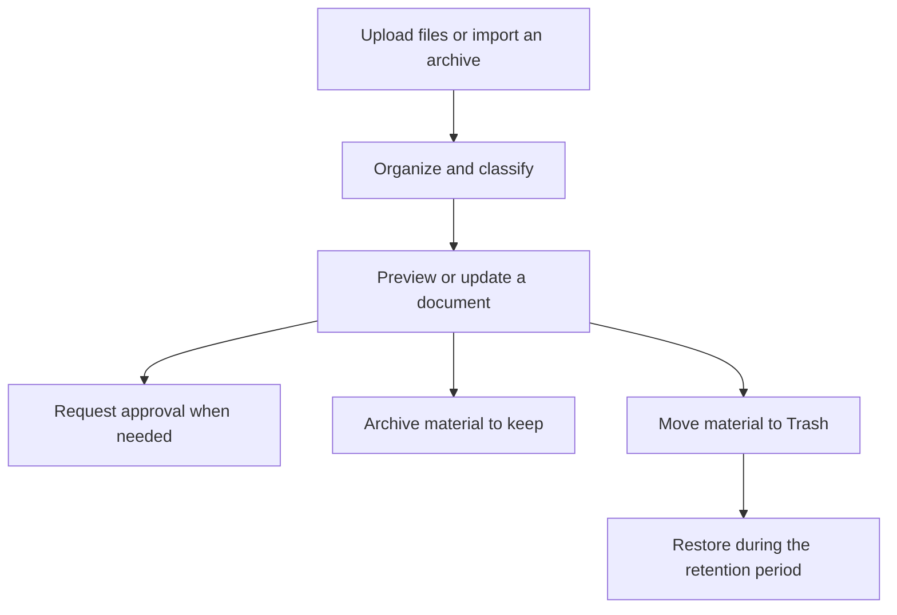
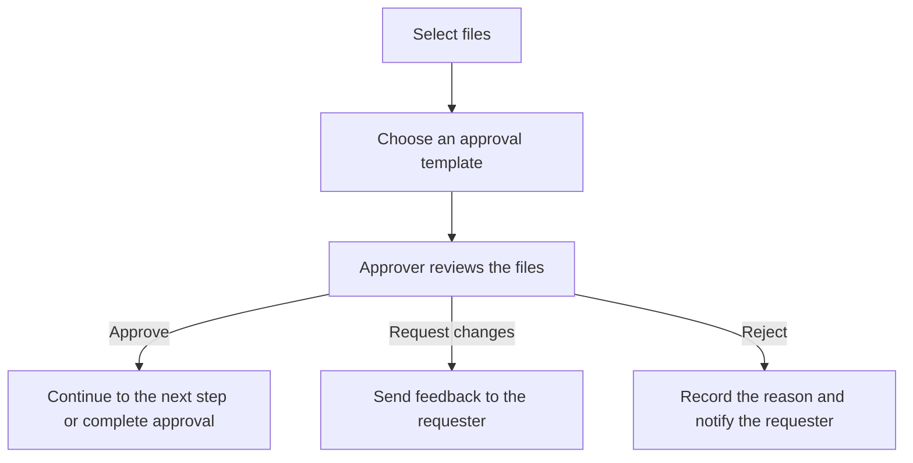
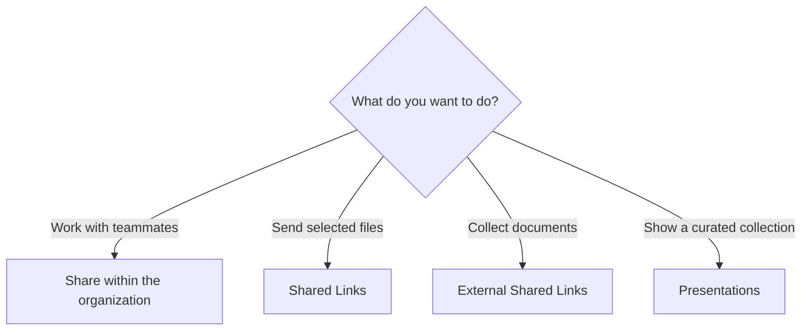

<h1 align="center">📁 SpectraVault</h1>

  <strong>Document management, approvals, and sharing for organizations</strong>

  <a href="https://vault.spectraeye.app/">Open SpectraVault</a> ·
  <a href="#-work-with-documents">Documents</a> ·
  <a href="#-workflows-and-approvals">Approvals</a> ·
  <a href="#-share-and-collaborate">Sharing</a> ·
  <a href="#-manage-your-organization">Organization</a> ·
  <a href="#-get-started">Get started</a>

---

## 📘 Introduction

SpectraVault gives your organization one workspace for files, review decisions, and external delivery. A team can collect documents, organize them, route them for approval, and follow up on what happened after sharing. Available features and actions depend on your organization's settings, plan, and assigned permissions.

## 📂 Work with documents

| Area | What you can do |
| --- | --- |
| **All files** | Upload files to folders, preview supported formats, and download individual files or a selection. Switch between list and grid views and choose which columns to show. |
| **Find and organize** | Search and filter files, revisit recent items, or use **Pinned** for personal shortcuts. Use tags and classifications to make documents easier to find and handle consistently. |
| **File actions** | Rename, move, tag, archive, or trash selected items when permitted. Lock a file when changes need to be limited. |
| **Versions and duplicates** | Review, compare, or restore earlier versions when available. For a duplicate upload, choose the offered action, such as skipping it, replacing the file, adding a version, or renaming it. |
| **Archives and Trash** | Import supported archives or package selected files. Keep material in **Archives** outside active work, and restore deleted items from **Trash** within the retention period. |
| **Operations** | Follow the progress of uploads, archive tasks, and download packages when they take time to finish. |

### Document lifecycle

## 🧭 Workflows and approvals

- Create reusable approval templates with one or more steps. Start a workflow from selected files and add context or a due date when needed.
- Open **Pending approvals** to review assigned work. Approve, reject with a reason, or request changes. Add decision attachments where available.
- Follow active workflows and their history. Use **Workflow Storage** to find files associated with approval work.
- Set out-of-office delegation for a defined period when you need a teammate to cover assigned approvals.
- Configure review rules for activities such as external uploads, archive actions, or file removal where your organization uses those policies. Assigned approvers can receive notifications.

## 🤝 Share and collaborate

### Share or collect files

- **Share with teammates.** Give people access to files and folders according to their roles, groups, and item permissions.
- **Send files to external recipients.** Use **Shared Links** to send selected files. Review expiry, download limits, and available activity before extending or revoking a link.
- **Collect files from external recipients.** Use **External Shared Links** to create a file request for a destination folder. Review incoming uploads and use request presets when you want to reuse the same choices.

### Presentations

Arrange selected files or albums in a public presentation. Preview the recipient's view before sharing, then update, unpublish, or archive the presentation when the material changes.

Where enabled, add polls, quizzes, or surveys. Review available views, reactions, comments, and responses to see how people interact with the presentation.

## 💬 Notes, chat, and notifications

- Use **Notes** for work notes and reminders you want to revisit.
- Use **Chat** for direct messages or group conversations. Mute a conversation when you want fewer notifications from it.
- Check notifications for assigned approvals, reminders, and support replies. Use product surveys or the feedback option in **Help** to share your experience.

## 📊 Dashboard, reports, and activity

- Open **Dashboard** for an overview of storage, shared links, and work that needs attention.
- Use **Reports** to review available trends such as storage growth, downloads, external uploads, sharing, and retention activity. Filter by date when comparing periods.
- In **Activity Log**, filter recorded changes by date, member, action, or item to see what changed in your workspace.

## 🏢 Manage your organization

The **Organization Owner** manages the workspace. Members can use the pages and actions granted by their assigned permissions.

| Area | What you can do |
| --- | --- |
| **Team** | Invite colleagues and choose their roles. Resend or revoke pending invitations, and change member access where permitted. |
| **Roles and groups** | Use built-in roles or create custom roles for specific responsibilities. Organize teammates into groups and use group access where supported. |
| **Ownership transfer** | The Owner can request a transfer to an eligible member. Ownership changes when that member accepts. |
| **Organization Settings** | Manage workspace details and branding, file and sharing rules, retention, and notifications where your role allows. |
| **Classifications and Presets** | Maintain the labels your team uses for documents and the reusable defaults for external file requests. |
| **Storage** | Review used and available space and the limits that apply to your organization. |
| **Integrations** | Connect your own tools to Vault when your role and workspace allow integration access. |
| **Data Export** | Download organization records and settings. Save copies of the documents you need separately. |

Authorized members can also close an organization permanently from **Organization Settings** after reviewing and confirming what will be removed.

## 🗓️ Plans and renewals

**License and Billing** shows your organization's current term, available offers, and renewal requests. A new organization can start with a 30-day Trial. After a trial or paid term ends, the seven-day grace period gives the team time to renew before regular workspace access ends.

The Owner and members with billing management permission can request an available monthly or annual offer and withdraw a pending request. Monthly renewal can be turned off while the current term continues and turned back on where available.

After grace ends, members can contact support from **Account Access**. Members with billing access can also review subscription options.

## 🚀 Get started

1. Open [SpectraVault](https://vault.spectraeye.app/).
2. Follow your invitation to join an organization. To set up a workspace, choose **Create Organization** when it is available, confirm your email, and complete the account setup shown. Use **Resend confirmation email** if the message does not arrive and the option is available.
3. Open **Account Settings** to update your display name, profile photo, timezone, or date preferences.
4. Open **Help** and search for a chapter or topic by title, description, or the steps it contains.

For a product issue, use **Report a Bug** and follow replies in the same conversation.

---

  <strong>Built with ❤️ by the SpectraEYE Team</strong>

